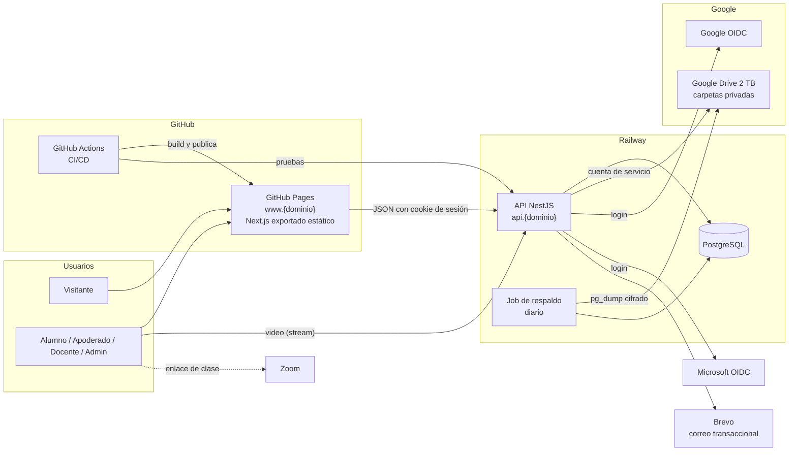
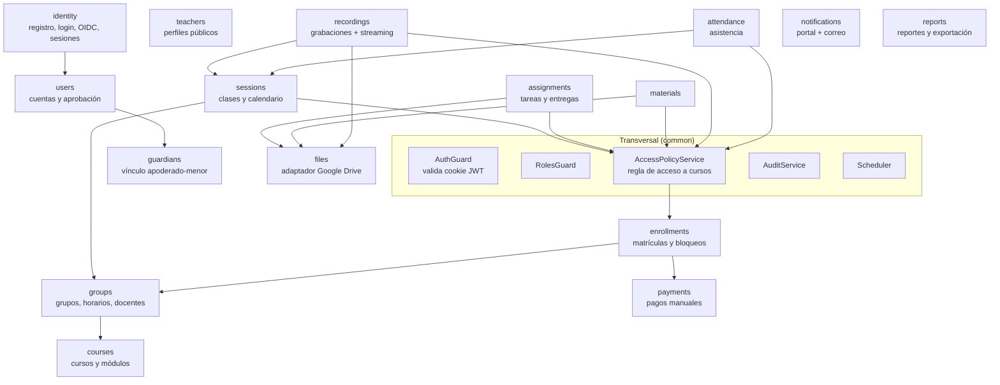

# 01 — Arquitectura de solución

## 1. Principios
1. **Simple de operar por una sola persona con IA**: pocos servicios, convenciones estándar, todo en un repositorio.
2. **El backend decide todo acceso.** El frontend solo muestra lo que la API entrega.
3. **Monolito modular**: un backend, módulos con límites claros. Sin microservicios.
4. **Económico**: ~US$ 35–55/mes en operación.
5. **Ningún recurso privado tiene URL pública permanente** (videos, materiales, entregas).

## 2. Vista de despliegue



| Componente | Tecnología | Dónde | Responsabilidad |
|---|---|---|---|
| Frontend | Next.js + TypeScript + Tailwind (`output: 'export'`) | GitHub Pages | Portal público (HTML estático, SEO) y campus (SPA que consume la API) |
| Backend | NestJS + TypeScript, API REST + Swagger | Railway (contenedor Docker) | Autenticación, permisos, reglas de negocio, streaming de video, jobs programados |
| Base de datos | PostgreSQL 16 + Prisma | Railway | Datos de la plataforma (estimado < 1 GB) |
| Archivos | Google Drive (plan 2 TB) | Google | Grabaciones, materiales, entregas de tareas, respaldos |
| Correo | Brevo (plan gratuito, 300/día) | SaaS | Verificación, recuperación, avisos |
| Identidad externa | Google y Microsoft (OIDC) | — | Solo autenticación; la autorización es nuestra |

**Dominio:** el frontend y la API deben vivir bajo el **mismo dominio** (`www.{dominio}` y `api.{dominio}`) para que la cookie de sesión funcione entre ambos. Es obligatorio antes de producción.

## 3. Frontend

### 3.1 Restricciones de GitHub Pages
GitHub Pages sirve solo archivos estáticos, así que Next.js se exporta (`next build` con `output: 'export'`):
- **Sí**: páginas generadas en build, componentes cliente, TanStack Query para datos del campus.
- **No**: middleware, server actions, API routes, optimización de `next/image`, rutas dinámicas no conocidas en build.
- Por eso las rutas del campus usan **parámetros de consulta** (`/campus/alumno/curso?g=<id>`) en vez de segmentos dinámicos.
- Cuando el admin cambia cursos, docentes o grupos, el botón **"Publicar portal"** llama a la API, que dispara un `repository_dispatch` de GitHub Actions y vuelve a construir el sitio (~2 min).

### 3.2 Mapa de rutas

| Zona | Ruta | Generación |
|---|---|---|
| Portal | `/` | Estática |
| Portal | `/nosotros` | Estática |
| Portal | `/programas` | Estática (catálogo) |
| Portal | `/programas/[slug]` | Estática por curso (`generateStaticParams` desde la API en build) |
| Portal | `/kids-teens` | Estática |
| Portal | `/docentes`, `/docentes/[slug]` | Estática |
| Portal | `/proximos-inicios` | Estática + refresco de cupos en cliente |
| Portal | `/contacto`, `/privacidad`, `/terminos`, `/libro-de-reclamaciones` | Estática |
| Campus | `/campus/login`, `/campus/registro`, `/campus/recuperar` | Cliente |
| Campus | `/campus/alumno` (+ `curso`, `calendario`, `tareas`, `perfil`) | Cliente |
| Campus | `/campus/apoderado` (+ `hijo?s=<id>`) | Cliente |
| Campus | `/campus/docente` (+ `grupo`, `sesion`, `asistencia`, `tareas`) | Cliente |
| Campus | `/campus/admin` (+ `solicitudes`, `usuarios`, `cursos`, `grupos`, `matriculas`, `pagos`, `reportes`, `auditoria`) | Cliente |

### 3.3 Estructura interna
```
frontend/
  app/
    (portal)/            páginas públicas
    campus/              páginas privadas por rol
  components/
    ui/                  Button, Input, Select, Modal, Card, Badge, Table…
    academy/             CourseCard, TeacherCard, Calendar, VideoPlayer,
                         AttendanceButton, PaymentStatus, NotificationPanel
  lib/
    api/                 cliente HTTP tipado (generado desde OpenAPI)
    auth/                estado de sesión en cliente (solo UX)
  styles/tokens.css      tokens de EMC INNOVATE
```
Tokens de marca tomados de `ProyectoPersonal/EMC-INNOVATE/css/style.css`: fondo `#060d1c`, superficie `#0e1c38`, azul `#1e6bff`, azul claro `#4f8cff`, marino `#0a1d3d`, texto `#f4f7fc`; Sora (títulos) + Inter (texto); radios 16/10 px; botones pill.

## 4. Backend

### 4.1 Módulos



Cada módulo: `controller` (HTTP + DTO validados) → `service` (reglas) → Prisma. **Ningún controller consulta la BD directamente** y **toda lectura de contenido de curso pasa por `AccessPolicyService`**.

### 4.2 Jobs programados (`@nestjs/schedule`, zona America/Lima, BD en UTC)
| Frecuencia | Job |
|---|---|
| cada 5 min | Cerrar asistencia de clases terminadas → crear **Falta** a quien no marcó |
| diario 07:00 | Correo de recordatorio de clases del día |
| diario 09:00 | Aviso "pago vence en 2 días" (día 5) y "acceso bloqueado" (día 8) |
| diario 03:00 | Respaldo de BD (`pg_dump` → cifrado → carpeta privada de Drive; retiene 30 diarios + 12 mensuales) |
| mensual | Marcar como archivadas las grabaciones con acceso vencido (> fin + 6 meses) para que el admin decida borrarlas de Drive |

El **bloqueo por pago no es un job**: se calcula en cada petición (ver [03](03-roles-y-permisos.md)), así nunca queda desfasado.

### 4.3 Streaming de video desde Drive
1. El admin sube el MP4 de Zoom a la carpeta privada de Drive y lo asocia a la clase en el campus (pega el enlace o elige el archivo).
2. El alumno abre `<video src="https://api.{dominio}/recordings/{id}/stream">`; el navegador envía la cookie de sesión.
3. La API valida sesión + `AccessPolicyService`, y pide a Drive el rango de bytes solicitado (`Range`) con la cuenta de servicio, reenviándolo al navegador (permite adelantar/retroceder).
4. El alumno nunca ve un enlace de Drive. Si se bloquea o vence el acceso, deja de reproducir de inmediato.

Costo asociado: el tráfico de video sale de Railway (~350 GB/mes ≈ US$ 15–20).

## 5. Seguridad
| Tema | Medida |
|---|---|
| Transporte | HTTPS obligatorio (Pages y Railway con TLS), HSTS |
| Contraseñas | Argon2id; política mínima de 10 caracteres; bloqueo progresivo tras intentos fallidos |
| Sesión | Access token JWT 15 min + refresh token rotativo (hash en BD, revocable) en **cookies httpOnly, Secure, SameSite=Lax, Domain=.{dominio}** |
| CSRF | SameSite=Lax + verificación de `Origin` en peticiones que modifican datos |
| CORS | Solo `https://www.{dominio}` con credenciales |
| OIDC | Flujo Authorization Code + PKCE + `state` + `nonce`; se vincula por `sub` del proveedor, **nunca solo por correo** |
| Autorización | RolesGuard + AccessPolicyService por recurso en cada endpoint; pruebas automáticas por regla |
| Entrada | DTO con `class-validator`, límites de tamaño, lista blanca de tipos de archivo |
| Abuso | Rate limit (`@nestjs/throttler`) en login, registro, recuperación y marca de asistencia |
| Secretos | Variables de entorno de Railway (clave de cuenta de servicio de Drive, secretos JWT, OIDC, Brevo). Nunca en el repo |
| Cabeceras | `helmet` (CSP, X-Frame-Options, etc.) |
| Auditoría | Aprobaciones, rechazos, bloqueos, pagos, correcciones de asistencia, cambios de rol |
| Menores | Consentimiento del apoderado registrado (versión de texto + fecha); datos mínimos; ningún alumno ve datos de otro |
| Ley 29733 | Política de privacidad que declara transferencia internacional (servidores en EE. UU.), finalidad y derechos ARCO |

## 6. Ambientes
| Ambiente | Frontend | Backend + BD | Uso |
|---|---|---|---|
| DEV | `next dev` local | NestJS local + PostgreSQL en Docker Compose | Desarrollo |
| QAS | Servicio estático en Railway (staging) | Entorno "staging" de Railway con BD propia | Pruebas antes de publicar |
| PRD | GitHub Pages | Entorno "production" de Railway | Producción |

## 7. CI/CD
- **Pull request** → GitHub Actions: lint, typecheck, pruebas unitarias y de integración (PostgreSQL en servicio de Actions).
- **Merge a `main`** → Railway despliega el backend (con `prisma migrate deploy` antes de arrancar) y Actions publica el frontend en Pages.
- **Rollback**: Railway permite volver al despliegue anterior en un clic; Pages se revierte con `git revert`. Las migraciones de BD se escriben siempre compatibles hacia atrás (agregar antes de quitar).

## 8. Observabilidad
- Logs estructurados JSON (sin datos personales sensibles) en Railway.
- Endpoint `/health` y monitor externo gratuito (UptimeRobot) con alerta por correo.
- Errores de frontend y backend: Sentry (plan gratuito).

## 9. Dimensionamiento y costos
| Concepto | Estimación |
|---|---|
| Grabación por grupo | 16 × 2 h ≈ 15 GB |
| Video almacenado simultáneo | ~0.5–0.7 TB |
| Tráfico de video | ~350 GB/mes |

| Servicio | US$/mes aprox. |
|---|---|
| GitHub Pro (Pages desde repo privado) | 4 |
| Railway (API + PostgreSQL + staging) | 10–20 |
| Tráfico de video desde Railway | 15–20 |
| Google One 2 TB | 10 |
| Brevo, Sentry, UptimeRobot (gratuitos) | 0 |
| **Total** | **~40–55** + dominio (~US$ 15–40/año) |

Precios referenciales; verificar al contratar.

## 10. Riesgos
| Riesgo | Impacto | Mitigación |
|---|---|---|
| Drive limita descargas o falla el streaming con muchos alumnos a la vez | Videos no cargan | Adaptador `files` aislado: migrar a Bunny Stream o Cloudflare R2 sin tocar el resto |
| Tráfico de video encarece Railway | Costo | Monitorear consumo mensual; umbral de alerta; plan B Bunny Stream |
| Un solo mantenedor | Continuidad | `CLAUDE.md`, ADRs, pruebas de reglas críticas, despliegue automatizado |
| Alumno reenvía el enlace de Zoom | Acceso no autorizado a la clase en vivo | MVP: enlace visible solo a matriculados con acceso; fase posterior: registro de Zoom por alumno |
| Asistencia marcada sin estar en Zoom | Asistencia inflada | Aceptado en MVP (asistencia flexible); fase posterior: contrastar con reportes de Zoom |
| Datos de menores | Legal / reputación | Consentimiento del apoderado, mínimo de datos, auditoría, política de privacidad |
| Repo público expondría código | Seguridad | Repo privado + GitHub Pro |

## 11. Estructura del repositorio
```
emc-academy/                    (monorepo privado)
  CLAUDE.md                     reglas de negocio y convenciones para la IA
  README.md
  docs/                         esta documentación + ADRs
  frontend/                     Next.js (export estático)
  backend/
    src/
      common/                   guards, AccessPolicyService, auditoría, errores
      modules/                  identity, users, guardians, teachers, courses,
                                groups, enrollments, payments, sessions,
                                attendance, recordings, materials, assignments,
                                notifications, reports, files
    prisma/
      schema.prisma
      migrations/
      seed.ts                   6 cursos, roles, admin inicial
    test/                       pruebas de reglas de acceso y flujos
    Dockerfile
  docker-compose.yml            PostgreSQL para DEV
  .github/workflows/
    ci.yml                      lint + typecheck + pruebas
    deploy-frontend.yml         build y publicación en Pages
```
