# 02 — Modelo de datos (PostgreSQL)

Convenciones: PK `uuid`; `created_at`/`updated_at` en todas las tablas; `deleted_at` (borrado lógico) en usuarios, cursos, grupos, materiales y grabaciones; fechas en UTC; montos en **céntimos** (`45000` = S/ 450.00).

## ERD

```mermaid
erDiagram
  users ||--o{ user_roles : tiene
  users ||--o{ user_identities : "inicia sesión con"
  users ||--o{ auth_sessions : "sesiones"
  users ||--o{ account_requests : solicita
  users ||--o| student_profiles : "es alumno"
  users ||--o| guardian_profiles : "es apoderado"
  users ||--o| teacher_profiles : "es docente"

  student_profiles ||--o{ student_guardians : ""
  guardian_profiles ||--o{ student_guardians : ""

  courses ||--o{ course_modules : contiene
  courses ||--o{ academic_groups : "se dicta en"
  academic_groups ||--o{ group_teachers : ""
  teacher_profiles ||--o{ group_teachers : ""

  student_profiles ||--o{ enrollments : ""
  academic_groups ||--o{ enrollments : ""
  enrollments ||--o{ payments : ""

  academic_groups ||--o{ class_sessions : "16 clases"
  class_sessions ||--o{ attendance_records : ""
  student_profiles ||--o{ attendance_records : ""
  attendance_records ||--o{ attendance_adjustments : ""

  class_sessions ||--o| recordings : ""
  recordings ||--o{ recording_views : ""
  academic_groups ||--o{ materials : ""
  academic_groups ||--o{ assignments : ""
  assignments ||--o{ assignment_submissions : ""
  student_profiles ||--o{ assignment_submissions : ""

  users ||--o{ notifications : recibe
  users ||--o{ audit_logs : "actor"

  users {
    uuid id PK
    citext email UK "nulo si cuenta gestionada"
    citext username UK "opcional, menores sin correo"
    timestamptz email_verified_at
    text password_hash "Argon2id, nulo si solo OIDC"
    text full_name
    text phone
    enum status "PENDING_VERIFICATION|PENDING_APPROVAL|ACTIVE|SUSPENDED|REJECTED"
    uuid managed_by_guardian_id FK "nulo"
  }
  user_roles {
    uuid user_id FK
    enum role "ADMIN|TEACHER|STUDENT|GUARDIAN"
  }
  user_identities {
    uuid id PK
    uuid user_id FK
    enum provider "GOOGLE|MICROSOFT"
    text provider_subject "UK con provider"
    citext provider_email
  }
  auth_sessions {
    uuid id PK
    uuid user_id FK
    text refresh_token_hash
    timestamptz expires_at
    timestamptz revoked_at
  }
  account_requests {
    uuid id PK
    uuid user_id FK
    enum requested_role
    enum status "PENDING|APPROVED|REJECTED"
    uuid reviewed_by FK
    text review_notes
  }
  student_profiles {
    uuid user_id PK
    date birth_date
    text school "opcional"
  }
  guardian_profiles {
    uuid user_id PK
    enum document_type "DNI|CE|PASAPORTE"
    text document_number
  }
  student_guardians {
    uuid student_id FK
    uuid guardian_id FK
    text relationship
    enum status "PENDING_GUARDIAN|PENDING_ADMIN|APPROVED|REVOKED"
    timestamptz consent_at
    text consent_version
  }
  teacher_profiles {
    uuid user_id PK
    text slug UK
    text bio
    text photo_url
    text specialties
    bool is_public
  }
  courses {
    uuid id PK
    text slug UK
    text name
    enum line "PROGRAM|KIDS_TEENS"
    int level "1-3 en Kids, nulo en Programas"
    text summary
    text description
    int price_cents "45000"
    char currency "PEN"
    int total_hours "32"
    enum status "DRAFT|PUBLISHED|ARCHIVED"
  }
  course_modules {
    uuid id PK
    uuid course_id FK
    int position
    text title
  }
  academic_groups {
    uuid id PK
    uuid course_id FK
    text code UK
    date start_date
    date end_date
    jsonb schedule "días y hora"
    text zoom_url "visible solo con acceso"
    int capacity
    enum status "PLANNED|ENROLLING|IN_PROGRESS|FINISHED|CANCELLED"
  }
  group_teachers {
    uuid group_id FK
    uuid teacher_id FK
  }
  enrollments {
    uuid id PK
    uuid student_id FK
    uuid group_id FK "UK con student_id"
    uuid requested_by FK "alumno o apoderado"
    enum status "REQUESTED|APPROVED|REJECTED|CANCELLED"
    int price_cents "precio pactado"
    int discount_cents
    bool manual_block
    text block_reason
    uuid approved_by FK
  }
  payments {
    uuid id PK
    uuid enrollment_id FK
    int amount_cents
    enum method "YAPE|PLIN|TRANSFER|CASH|OTHER"
    text operation_number
    date paid_on
    uuid registered_by FK
    timestamptz voided_at
    text void_reason
  }
  class_sessions {
    uuid id PK
    uuid group_id FK
    int number "1-16"
    timestamptz starts_at
    timestamptz ends_at
    enum status "SCHEDULED|RESCHEDULED|DONE|CANCELLED"
    timestamptz attendance_closed_at
  }
  attendance_records {
    uuid id PK
    uuid session_id FK
    uuid student_id FK "UK con session_id"
    enum status "PRESENT|ABSENT|JUSTIFIED"
    timestamptz marked_at "hora del servidor"
    enum source "STUDENT|TEACHER|SYSTEM"
  }
  attendance_adjustments {
    uuid id PK
    uuid record_id FK
    enum from_status
    enum to_status
    text reason
    uuid changed_by FK
  }
  recordings {
    uuid id PK
    uuid session_id FK
    text drive_file_id
    int duration_seconds
    bigint size_bytes
    enum status "DRAFT|PUBLISHED|ARCHIVED"
  }
  recording_views {
    uuid recording_id FK
    uuid user_id FK
    int progress_seconds
  }
  materials {
    uuid id PK
    uuid group_id FK
    uuid session_id FK "opcional"
    enum kind "FILE|LINK"
    text title
    text drive_file_id
    text url
    bool published
  }
  assignments {
    uuid id PK
    uuid group_id FK
    text title
    text description
    timestamptz due_at
  }
  assignment_submissions {
    uuid id PK
    uuid assignment_id FK
    uuid student_id FK "UK con assignment_id"
    jsonb files "ids de Drive"
    timestamptz submitted_at
    text feedback
    uuid feedback_by FK
    enum status "SUBMITTED|REVIEWED"
  }
  notifications {
    uuid id PK
    uuid user_id FK
    text type
    text title
    text body
    text link
    timestamptz read_at
    timestamptz emailed_at
  }
  audit_logs {
    uuid id PK
    uuid actor_id FK
    text action
    text entity
    uuid entity_id
    jsonb before
    jsonb after
    inet ip
  }
```

## Reglas de integridad
| Regla | Implementación |
|---|---|
| Una sola asistencia por alumno y clase | `UNIQUE (session_id, student_id)` en `attendance_records` |
| Una matrícula por alumno y grupo | `UNIQUE (student_id, group_id)` en `enrollments` |
| Identidad externa única | `UNIQUE (provider, provider_subject)` |
| Una entrega por tarea y alumno (se puede reemplazar antes de revisión) | `UNIQUE (assignment_id, student_id)` |
| Montos positivos | `CHECK (amount_cents > 0)` |
| Correo o usuario obligatorio | `CHECK (email IS NOT NULL OR username IS NOT NULL)` |
| Cuenta gestionada solo para menores | `managed_by_guardian_id` requiere `birth_date` < 18 años (validado en servicio) |

## Valores derivados (no se guardan)
| Valor | Cálculo |
|---|---|
| Pagado | `SUM(payments.amount_cents WHERE voided_at IS NULL) >= price_cents - discount_cents` |
| Saldo | `price_cents - discount_cents - pagado` |
| Fin del plazo de pago | `academic_groups.start_date + 7 días` |
| Acceso a grabaciones hasta | `academic_groups.end_date + 6 meses` |
| % asistencia | `PRESENT + JUSTIFIED` / clases con asistencia cerrada |
| Es menor | `birth_date` + 18 años > hoy |

## Índices principales
`enrollments(group_id, status)`, `enrollments(student_id)`, `class_sessions(group_id, starts_at)`, `attendance_records(student_id)`, `payments(enrollment_id)`, `notifications(user_id, read_at)`, `audit_logs(entity, entity_id)`, `account_requests(status)`.

## Retención
- Grabaciones: archivadas al vencer el acceso (fin + 6 meses); el admin decide borrarlas de Drive.
- Auditoría: 2 años.
- Sesiones revocadas o vencidas: se depuran a los 30 días.
- Cuentas eliminadas: borrado lógico; anonimización a solicitud del titular (derechos ARCO).
