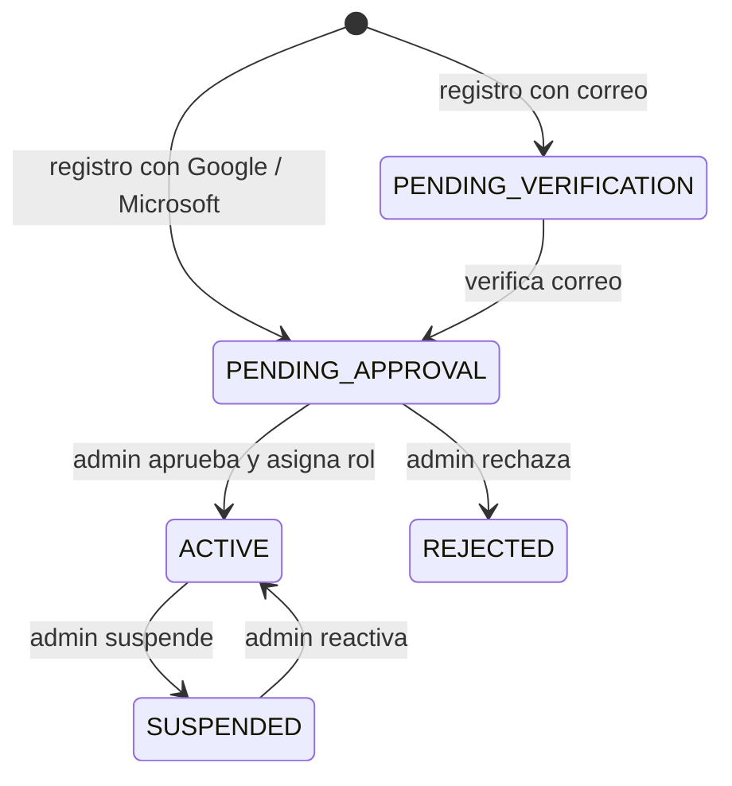
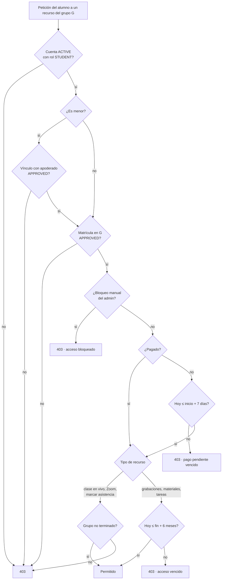

# 03 — Roles, permisos y regla de acceso

Toda verificación ocurre en el **backend**. El frontend oculta botones solo por comodidad.

## 1. Estados de cuenta

Solo `ACTIVE` puede usar el campus. Los demás estados ven únicamente una pantalla de "solicitud en revisión".

## 2. Regla de acceso al contenido de un curso
Implementada una sola vez en `AccessPolicyService` y cubierta por pruebas automáticas.

Las respuestas 403 incluyen un código (`ACCOUNT_NOT_ACTIVE`, `GUARDIAN_NOT_APPROVED`, `ENROLLMENT_NOT_APPROVED`, `MANUAL_BLOCK`, `PAYMENT_OVERDUE`, `ACCESS_EXPIRED`) para que el frontend muestre el mensaje correcto.

## 3. Matriz de permisos

Leyenda: ✅ total · 👁 solo lectura · 🔒 solo lo suyo · ➖ sin acceso

| Recurso / acción | Admin | Docente | Alumno | Apoderado |
|---|---|---|---|---|
| Aprobar/rechazar cuentas, asignar roles | ✅ | ➖ | ➖ | ➖ |
| Suspender/reactivar usuarios | ✅ | ➖ | ➖ | ➖ |
| Cursos y módulos (crear/editar) | ✅ | ➖ | ➖ | ➖ |
| Grupos (crear, horario, Zoom, asignar docente) | ✅ | 👁 sus grupos | ➖ | ➖ |
| Publicar portal (reconstruir sitio) | ✅ | ➖ | ➖ | ➖ |
| Solicitar matrícula | ✅ | ➖ | 🔒 para sí | 🔒 para sus hijos |
| Aprobar/rechazar matrícula | ✅ | ➖ | ➖ | ➖ |
| Bloquear/desbloquear matrícula | ✅ | ➖ | ➖ | ➖ |
| Registrar/anular pagos | ✅ | ➖ | ➖ | ➖ |
| Ver estado de pago | ✅ | ➖ | 🔒 | 🔒 de sus hijos |
| Ver alumnos de un grupo | ✅ | 🔒 sus grupos | ➖ | ➖ |
| Enlace Zoom | ✅ | 🔒 sus grupos | 🔒 con acceso | ➖ |
| Marcar asistencia propia | ➖ | ➖ | 🔒 durante la clase | ➖ |
| Justificar / corregir asistencia (con motivo) | ✅ | 🔒 sus grupos | ➖ | ➖ |
| Ver asistencia | ✅ | 🔒 sus grupos | 🔒 | 🔒 de sus hijos |
| Publicar grabaciones y materiales | ✅ | 🔒 sus grupos | ➖ | ➖ |
| Ver grabaciones y materiales | ✅ | 🔒 sus grupos | 🔒 con acceso | ➖ |
| Publicar tareas y dar comentarios | ✅ | 🔒 sus grupos | ➖ | ➖ |
| Entregar tareas | ➖ | ➖ | 🔒 con acceso | ➖ |
| Ver tareas y comentarios | ✅ | 🔒 sus grupos | 🔒 | 🔒 de sus hijos |
| Autorizar vínculo con un menor | ✅ aprueba | ➖ | ➖ | 🔒 autoriza |
| Reportes y exportación (Excel/PDF) | ✅ | 🔒 sus grupos | ➖ | ➖ |
| Auditoría | 👁 | ➖ | ➖ | ➖ |
| Perfil propio | ✅ | ✅ (+ perfil público) | ✅ | ✅ |

El apoderado no ve grabaciones ni materiales: son para el alumno. Ve el avance (asistencia, tareas entregadas y comentarios).

## 4. Pruebas obligatorias de autorización
Cada fila con 🔒 tiene al menos una prueba que demuestra que **otro** usuario del mismo rol recibe 403. Ejemplos: un docente intenta ver la asistencia de un grupo ajeno; un apoderado intenta ver a un menor no vinculado; un alumno pide el stream de una grabación de otro grupo; un alumno con pago vencido pide el enlace de Zoom.
