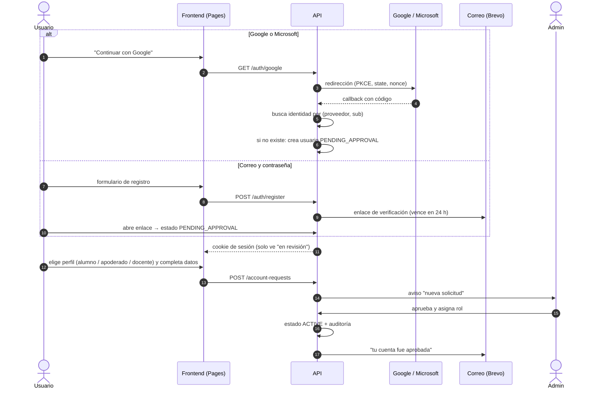
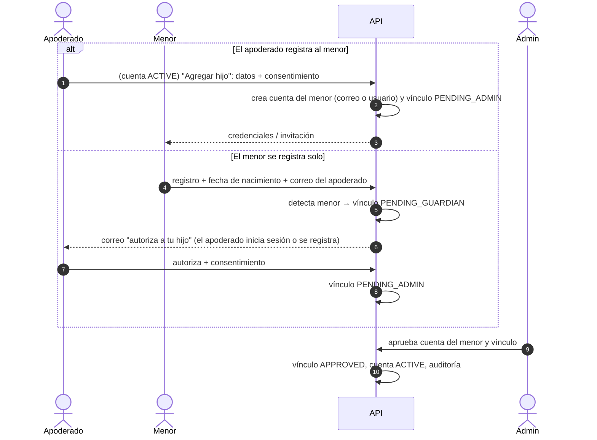
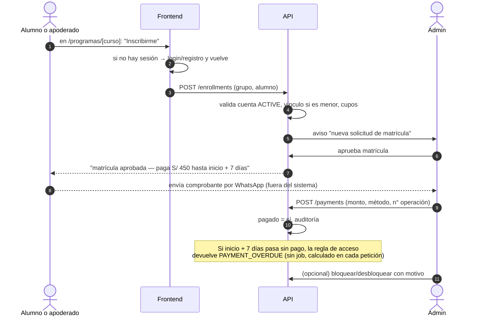
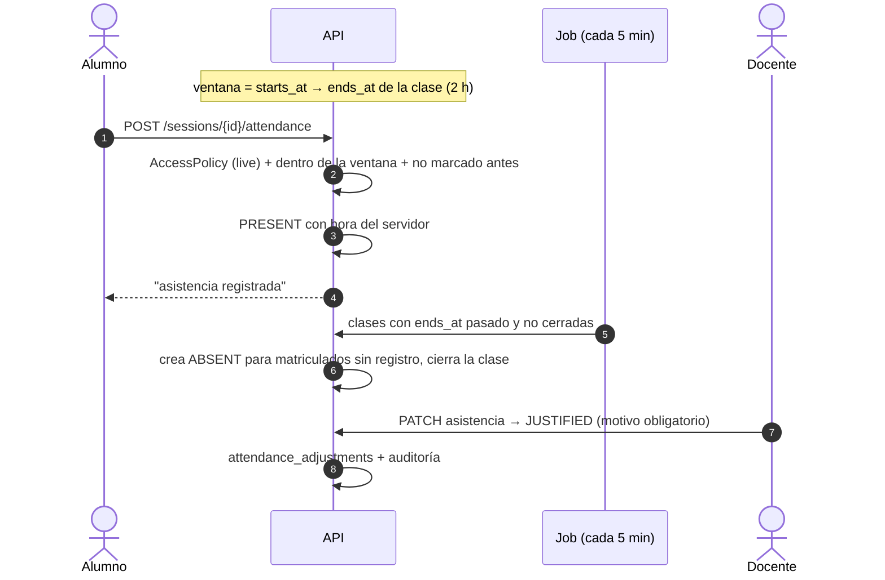
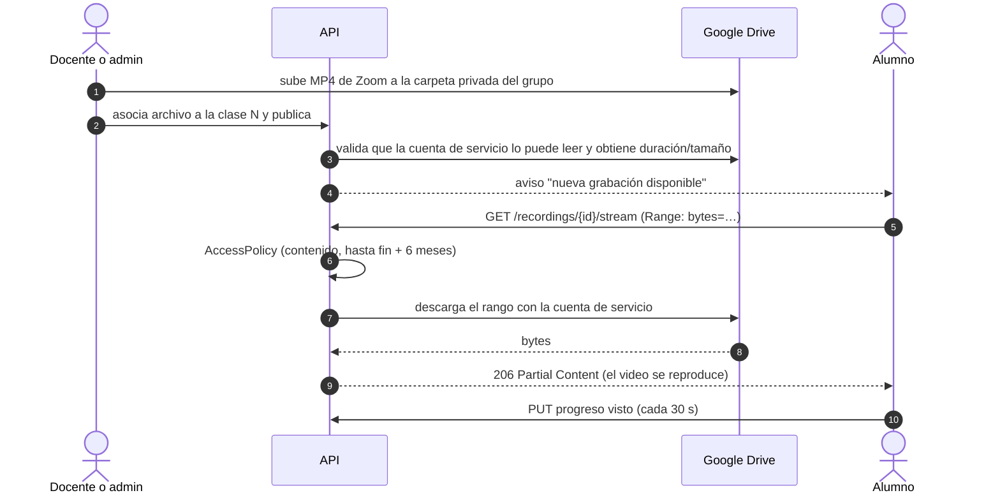
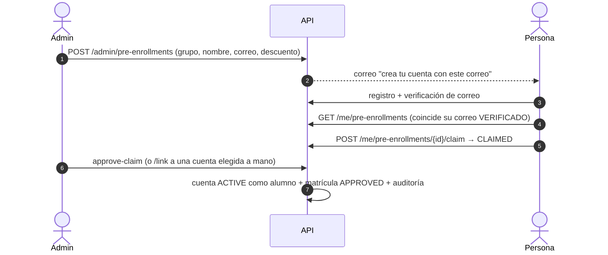

# 04 — Flujos principales

## 1. Registro y aprobación de cuenta

**Vincular otra forma de ingreso** (p. ej. agregar Google a una cuenta de correo): solo desde el perfil, con la sesión iniciada. Nunca automático por coincidencia de correo.

## 2. Menor de edad y apoderado

El consentimiento guarda la versión del texto aceptado, la fecha y la IP.

## 3. Inscripción, pago y bloqueo

> **Cambio 2026-11-22:** solo el administrador matricula (grupo → "Matricular alumno", o prematrícula). El diagrama conserva el pago y el bloqueo; los pasos de "Inscribirme" y aprobación de solicitud ya no aplican.

## 4. Asistencia

## 5. Grabación: publicación y reproducción

## 6. Prematrícula (admin registra antes de que exista la cuenta)

Nunca se vincula sola por coincidencia de correo: el admin siempre confirma. Para menores sin correo (cuenta con usuario creada por el apoderado), el admin usa "Vincular a otra cuenta…".

## 7. Solicitudes de matrícula (retiradas)

Desde 2026-11-22 alumnos y apoderados ya no pueden pedir matrícula (se quitaron `POST /enrollments` y la autorización del apoderado). Solo quedan `/admin/enrollments` para revisar o rechazar solicitudes hechas antes del cambio; el bloque del panel aparece solo si existe alguna.
